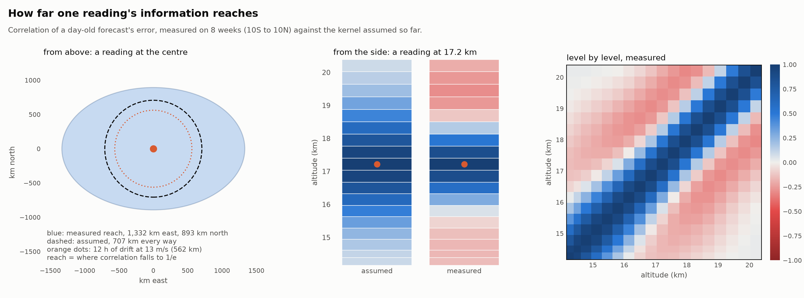
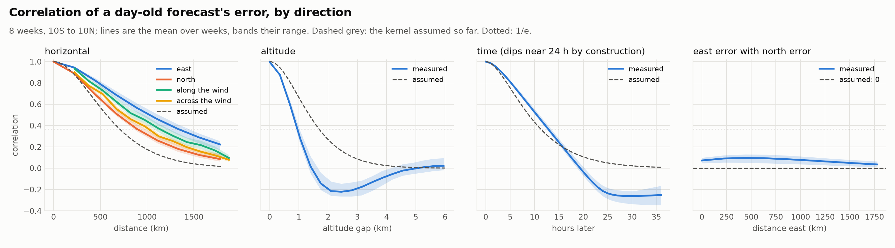

# Forecast-error correlation, measured (2026-11-18)

**Question.** If the forecast is wrong where the balloon is, how far away (sideways, up and down, later) is it
wrong in the same way? This is the K a belief update needs; until now we assumed a fitted Matern kernel.

**Data.** Eight summer weeks of ERA5, 10S to 10N, 18 levels, hourly (2020-05/06/07/08/09-16, 2021-05/06/08-16),
none of them the July 2021 week the sweeps fly on. Forecast = the truth 24 h earlier; error = truth − forecast,
each level's mean removed. Built by `~/balloon-records/build_weeks.sh` on Unicorn; measured by
`scripts/measure_error_covariance.py`, drawn by `scripts/plot_error_covariance.py` and `scripts/plot_error_reach.py`.

## Measured (8 weeks; the band in the curves is their range)

| direction | reach (correlation falls to 1/e) | assumed so far |
|---|---|---|
| east | 1,330 km | 707 km |
| north | 890 km | 707 km |
| along the wind / across | 1,130 / 1,020 km | 707 km |
| altitude | 0.9 km, then **negative** (about −0.2) 2 to 3 km away | 1.7 km, never negative |
| time | 12.8 h (then negative near 24 h, by construction) | 11.3 h |
| east error with north error | about +0.08 | 0 |

- **Sideways, a reading reaches about twice as far as assumed, and farther east–west than north–south.**
- **Vertically it reaches half as far, and 2–3 km away the error flips sign.** A reading saying "the forecast
  is 3 m/s too fast here" implies it is somewhat too slow 2–3 km above or below. The assumed kernel cannot say
  that. The level-by-level map shows the pattern holds at every altitude.
- **Stable.** The eight weeks agree closely, and the held-out July 2021 week falls inside their range at
  every lag checked.
- **The two components are nearly unrelated**, as assumed.

## Believed, unverified

- The sign flip with altitude looks like vertically propagating equatorial waves (layers of alternating wind
  error a few km thick). Not checked against the literature.

## Caveats

- The forecast is persistence, not a weather model. Its error is the day's change in wind, which may be
  structured differently from a real forecast's; the negative lobe in time is an artifact of this.
- The top-down shape is an ellipse drawn through the east and north reaches only.

## Next

Use this K in the belief, and compare MPC with readings on: no readings, the assumed kernel, the measured K.
