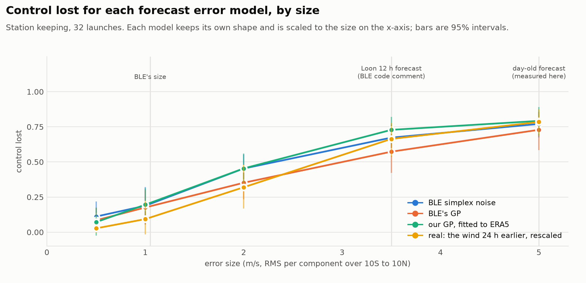

# Fidelity: forecast error models, by size (2026-11-18)

**Question.** If a simulator's forecast is built with a given error model, how much station-keeping control does
MPC lose when it plans on that forecast and flies in the real wind (ERA5)?

**Setup.** As the 2026-11-17 sweep (`docs/fidelity-results-2026-11-17.md`): station keeping within 50 km for 2
days, 10S to 10N, MPC on Pasetsky et al.'s settings, 32 launches, readings off. Control lost = (MPC on the truth
− MPC on the copy) ÷ (MPC on the truth − coast), in time within 50 km, with a 95% bootstrap interval over the
launches. MPC on the truth 0.438 and coast 0.081, reproduced exactly from the 11-17 sweep.

**Error models** (decision 56), each keeping its own shape, scaled to each size:

| model | where it is from | correlated over (space, height, time) |
|---|---|---|
| BLE simplex noise | BLE's simulator: truth = forecast + this noise (`env/simplex_wind_noise.py`) | five harmonics, ~150 to 10,000 km; ~600 Pa; 4 to 245 h |
| BLE's GP | what BLE's agents assume about the forecast (`env/wind_gp.py`) | 357 km; 326 Pa (~0.15 to 0.4 km here); 9.6 h; Matern 1/2 |
| our GP | fitted to ERA5's day-old error (`BeliefConfig`) | 544 km; 1.3 km; 9.1 h |
| real | the wind 24 h earlier, its error rescaled | whatever the real error has |

Sizes 0.5, 1, 2, 3.5 and 5 m/s RMS per component over the launch band. Marked on the figure: BLE's own size,
1.05 m/s (measured on its code), Loon's 12 h forecast error, 3.5 m/s (BLE's code comment, source not checked),
and a day-old forecast here, 5.0 m/s (measured).

| size (m/s) | BLE simplex | BLE's GP | our GP | real, rescaled |
|---|---|---|---|---|
| 0.5 | 0.11 [0.01, 0.22] | 0.08 [0.01, 0.18] | 0.07 [−0.03, 0.18] | 0.03 [0.00, 0.06] |
| 1 | 0.19 [0.05, 0.32] | 0.18 [0.06, 0.30] | 0.20 [0.08, 0.31] | 0.09 [−0.02, 0.22] |
| 2 | 0.45 [0.34, 0.55] | 0.35 [0.23, 0.48] | 0.45 [0.35, 0.56] | 0.32 [0.17, 0.48] |
| 3.5 | 0.67 [0.57, 0.77] | 0.57 [0.42, 0.71] | 0.73 [0.63, 0.82] | 0.66 [0.54, 0.78] |
| 5 | 0.77 [0.67, 0.86] | 0.73 [0.58, 0.85] | 0.79 [0.69, 0.89] | 0.78 [0.69, 0.87] |

## What it shows (measured)

- **Size sets the loss.** Every model loses more as it grows: about a fifth of the control at 1 m/s, a third to
  a half at 2, and three quarters at 5.
- **Shape changes little.** At each size the four models' intervals overlap. With 32 launches we cannot tell
  their shapes apart.
- **At BLE's own size the loss is small** (0.09 to 0.20). At a real day-old forecast's size it is large
  (0.73 to 0.79). A simulator built with BLE's noise as BLE sets it gives a forecast about five times better
  than a day-old one.

## Believed, unverified

- The real error's shape may be slightly gentler at small sizes (0.09 at 1 m/s against about 0.19). The
  intervals overlap; a paired comparison per launch would say whether it is real.

## Limits

One July week, 10S to 10N, one task, MPC only, readings off. BLE's models put on our grid assume flat km at the
equator and the standard atmosphere's pressure (decision 56).
